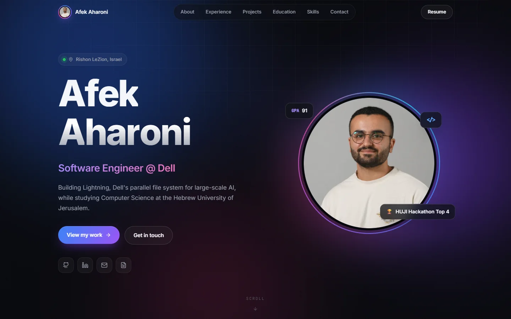

<div align="center">

# Afek Aharoni

**Computer Science @ The Hebrew University of Jerusalem · Software Engineering Intern @ Dell Technologies**

[**afekaharoni.github.io**](https://afekaharoni.github.io/)

[](https://linkedin.com/in/afek-aharoni)
[](mailto:afekaharoni@gmail.com)
[](https://github.com/AfekAharoni/afekaharoni.github.io/actions/workflows/static.yml)

<a href="https://afekaharoni.github.io/"></a>

</div>

## About

My personal portfolio: experience, projects, education and skills in one place.
I study Computer Science at the Hebrew University of Jerusalem and recently joined Dell Technologies as a Software Engineering Intern on the **Lightning** parallel file system team.

## Highlights

- **Animated hero** with letter-by-letter name reveal, typing roles and a parallax photo
- **Scroll-driven motion**: word-by-word section titles, a timeline that fills as you scroll, counters and grade bars that animate into view
- **Interactive cards** with a cursor-following spotlight and subtle 3D tilt
- **Fully responsive**, tested on iPhone, iPad and desktop, with hover effects limited to mouse users
- **Accessible** semantic markup, keyboard focus styles and support for reduced-motion preferences

## Tech stack

| Area      | Tools                                  |
| --------- | -------------------------------------- |
| Framework | React 18, TypeScript                   |
| Build     | Vite                                   |
| Animation | Framer Motion                          |
| Icons     | Lucide                                 |
| Hosting   | GitHub Pages, deployed with GitHub Actions |

## Run locally

```bash
npm install
npm run dev      # http://localhost:5173
npm run build    # production build in dist/
```

## Project structure

```
src/
  data.tsx         all site content (experience, projects, education, skills)
  components/      one component per section (Hero, Experience, Projects, ...)
  index.css        design tokens, layout and animations
public/            images, project icons and company logos
```

To update the site, edit `src/data.tsx` and push to `main`. GitHub Actions builds and deploys automatically.

---

<div align="center">
© 2026 Afek Aharoni
</div>
